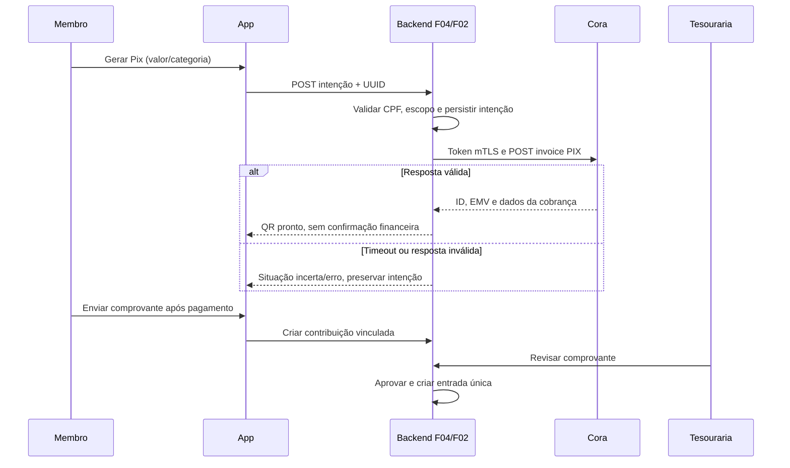

# F04 — Pix Cora na página de contribuições

20/10/2026. Revisão 0.2, proposta técnica para revisão; decisões de produto abaixo confirmadas pelo usuário. Extensão de F04, consumida por F08 e F07; não cria novo ID de feature. Fonte: [PRD v1.2](../../../PRD_Moriah_App_v1.md), seções de financeiro e evolução Pix. Base inspecionada: `f95d5798343fed88f3833f6e6b968765ad03f85e`. [Contrato](contract.md), [plano](plan.md), [tickets](tickets-propostos.md).

## Escopo e decisões

Criar QR Pix dinâmico da conta Cora da Igreja Moriah dentro da página de contribuições. Usuário confirmou: confirmação manual pela tesouraria com comprovante; CPF solicitado na contribuição e salvo privadamente no financeiro para reutilização; vencimento no dia da geração; sem juros, multa ou notificações Cora. Sem webhook, consulta bancária, baixa automática, boleto, transferência, conciliação ou integração com eventos nesta entrega. Autenticação é dependência técnica necessária.

O PRD posiciona pagamento integrado como evolução fora do MVP original. Este pedido autoriza sua especificação como extensão posterior, sem reescrever o PRD nem declarar expansão do MVP original. Implementação autorizada em 20/10/2026; credenciais e homologação ainda não estão disponíveis.

## Evidência atual

- `backend/apps/finance/models.py`: Contribution pertence a Church/Member; estados pending/approved/rejected/needs_review. FinancialEntry tem vínculo único com Contribution.
- `backend/apps/finance/services.py`: aprovação chama `ensure_contribution_financial_entry`, que cria entrada paga idempotente. Não chamar na geração do QR.
- `backend/apps/finance/views.py`: criação exige perfil de membro, revisão exige IsFinancialManager; extrato pessoal e listagens possuem escopo de igreja.
- `mobile/src/screens/NewContributionScreen.tsx`: envio com categoria, valor, data e comprovante obrigatório na UI. Preservar este caminho.
- `backend/apps/members/models.py`: Member não tem CPF. `serializers.py`/`views.py`: dados pessoais usam solicitação de alteração; MyMemberView é apenas leitura; serializer de membro também serve ao diretório.
- Baseline não tinha adaptador Cora. Implementação local adiciona cora.py, pix_views.py e modelos PixPayer/PixIntent.

## Comportamento verificável

R1. Usuário autenticado com perfil da igreja habilitada escolhe gerar Pix ou enviar comprovante. Sem perfil ou configuração Cora válida, não há chamada bancária. Admin sem Member segue a regra atual de criação.

R2. Solicitar CPF somente na geração Pix. Validar 11 dígitos e dígitos verificadores; rejeitar sequências repetidas. Salvar em PixPayer privado de F04, criptografado com Fernet e chave operacional CORA_DATA_KEY separada do banco. Nas próximas contribuições reutilizar o CPF salvo; permitir informar outro no próprio pagamento. Cadastro, onboarding e solicitações cadastrais não recebem CPF. A API de configuração retorna apenas presença e dois dígitos finais, nunca o documento completo. Somente o backend de pagamento o descriptografa. Sem unicidade global de CPF.

R3. Nome vem do membro, não vazio e até 60 caracteres; não truncar silenciosamente. Na primeira geração CPF ausente/ inválido impede chamada; em emissões seguintes pode ser omitido para reutilizar o anterior. Troca de CPF não muda snapshots de intenções já emitidas. Apenas pessoa física nesta entrega; sem CNPJ no formulário.

R4. Aceitar categorias atuais; valor BRL entre 5,00 e 99.999.999,99, em no máximo duas casas, compatível com Contribution. Limite superior local, sujeito à homologação Cora; erro do banco nunca vira sucesso. Vencimento calculado pelo backend no dia atual em America/Sao_Paulo. Sem data retroativa ou prazo escolhido pelo cliente. Valores em centavos inteiros no adaptador, sem float.

R5. Criar intenção persistente antes da chamada, vinculada a igreja, membro, ambiente e UUID idempotente. Duplo toque, concorrência, reinício ou resposta perdida reutilizam a operação e payload original. Mesma chave com dados diferentes retorna conflito. Não abrir transação de banco durante chamada HTTP. Resultado incerto permanece recuperável com a mesma chave, sem emitir nova cobrança automaticamente.

R6. Após resposta válida, exibir valor, favorecido configurado/verificado, vencimento, QR e Pix Copia e Cola. Copiar deve funcionar na web e Android/iOS. Mostrar “QR gerado — pagamento ainda não confirmado”. Copiar, fechar a tela ou informar que pagou não aprova contribuição. Resposta sem EMV ou com valor divergente não libera QR como válido.

R7. Intenção é separada de Contribution e FinancialEntry. Gerar, abandonar ou vencer QR não entra como receita, contribuição pendente nem notificação de aprovação. Usuário retoma a intenção própria pelo identificador persistido. Backend não consulta Cora para retomar.

R8. Após pagar, usuário anexa comprovante à intenção. Criação existente de contribuição aceita vínculo opcional à intenção; deriva categoria e valor dela, valida arquivo no servidor e grava vínculo/contribuição atomicamente. Uma intenção vincula no máximo uma contribuição; retry devolve a mesma, sem duplicar anexos. Extrato e revisão mostram origem Pix Cora e situação manual, sem sugerir confirmação do banco. A aprovação existente continua gerando exatamente uma entrada financeira.

R9. Vencimento não prova cancelamento: a documentação admite estado LATE. Depois da virada do dia não reexibir QR como vigente nem refazer emissão automaticamente; comprovante de pagamento continua submetível para revisão. Retentativa incerta que cruza o vencimento exige tratamento operacional, sem mudar payload/chave. Pagamento de QR antigo ou múltiplo não é reconciliado automaticamente neste escopo.

R10. Credenciais ficam exclusivamente no backend, ligadas à igreja e ambiente. Igreja sem configuração não pode usar conta da Moriah por fallback. Proposta inicial: configuração operacional por referência a segredo/arquivos, sem painel para upload de chave. Tokens, chave privada, CPF e corpo bancário completo não aparecem em auditoria. Auditoria usa IDs locais, etapa e erro sanitizado.

## Desenho técnico

F02 fornece somente identidade do membro; CPF é dado privado de F04. F04 fornece uma nova intenção Pix (PixIntent), adaptador Cora e vínculo opcional/único em Contribution. Persistir UUID, escopos, valor/categoria, data, estado local, ID Cora, EMV e SVG gerado localmente a partir do EMV. Guardar payload necessário à repetição de forma privada; CPF do pagador e snapshot de cada intenção são criptografados com chave operacional separada; preservar chave para ler históricos. Retenção: acompanha os registros privados financeiros, sem limpeza automática nesta entrega; sem rotina automática de descarte, acompanhando o histórico financeiro. Preferir não guardar resposta Cora completa.

Migrações aditivas, nenhuma coluna CPF em Member/User e nenhum backfill. Não alterar estados de Contribution para representar cobrança. Estados locais: creating → ready/error/uncertain; estado bruto da Cora é dado separado, nunca autorização de receita. API de criação não é cancelamento nem transferência. Desativar configuração bloqueia novas emissões, preservando comprovantes e registros históricos. Rollback de aplicação requer preservar colunas/dados até compatibilidade ser validada; não excluir intenções como rollback.

Proposta de autenticação: Integração Direta com client_id, certificado e chave privada mTLS, token com prazo retornado pelo servidor. Obter token novo por tentativa, sem cache; 401 preserva intenção para retomada explícita. Timeout HTTP de 20s por requisição (token e invoice); erro ambíguo não dispara novas chaves. Não baixar URL arbitrária enviada pelo cliente; renderizar QR a partir do EMV com biblioteca compatível com Expo, selecionada na implementação, ; implementação gera SVG no backend com qrcode e renderiza via react-native-svg, sem carregar URL externa. Clipboard usa expo-clipboard. Homologar QR real.

## Casos de borda e aceite

| Caso | Entrada/precondição | Resultado observável / evidência proposta |
|---|---|---|
| E1 / R1,R10 | anônimo, sem Member, outra igreja, configuração desligada | 401/403/404/503 conforme contrato; zero chamadas Cora e nenhum dado alheio |
| E2 / R2,R3 | CPF vazio sem documento salvo, repetido, DV inválido; nome >60 | erro de campo; nenhuma invoice; CPF válido informado no pagamento habilita jornada |
| E3 / R4 | 4,99 / 5,00 / zero / negativo / 3 decimais / acima do limite | rejeitar inválidos; 5,00 vira amount=500; não arredondar |
| E4 / R5 | dois POST simultâneos; resposta perdida; chave com valor alterado | uma intenção/invoice lógica; retry com chave original; alteração dá 409; teste PostgreSQL |
| E5 / R5,R6 | 401, 400, 415, 429, 5xx, timeout, falta EMV, valor divergente | erro sanitizado; formulário preservado; sem sucesso falso; sem nova chave |
| E6 / R6,R7 | gerar/copiar QR, sair e retomar | mesmo ID/EMV recuperado; nenhuma Contribution/FinancialEntry; clipboard e leitura por banco homologados |
| E7 / R9 | virada do dia, estado LATE, retry após vencimento | UI informa vencimento; não declara cancelado/pago; comprovante continua possível |
| E8 / R8 | comprovante inválido; envio simultâneo; aprovação repetida | inválido não cria contribuição; uma contribuição e uma entrada; isolamento e auditoria preservados |
| E9 / R8 | fluxo legado com comprovante, sem intenção | contrato, revisão, extrato e financeiro atuais continuam funcionando |
| E10 / R10 | inspeção de diretório, bundles, logs, notificações | nenhum CPF completo ou segredo; teste de autorização de dados privados |

Testes propostos via API pública, respostas controladas do adaptador e regressões de UI; fixtures sintéticas baseadas nas fontes abaixo, sem afirmar conformidade real. Homologação com credenciais stage e QR lido por aplicativo bancário é obrigatória para declarar integração comprovada. Não haverá teste de baixa automática. Registrar ambiente, horário, IDs sanitizados e resultado, sem dados pessoais.

## Gates existentes e execução

Fonte: `.github/workflows/ci.yml` e `mobile/package.json`. Comandos de referência abaixo; resultados executados estão no [relatório](validacao.md); dependências devem estar instaladas. Gates existentes permanecem exigidos pela CI.

| Gate | Comando / cwd | Pré-requisito e escopo |
|---|---|---|
| Backend | `python -m pytest -q` / backend | requirements-dev; SQLite de teste |
| Schema | `python manage.py spectacular --file /dev/null` / backend | Linux CI; DJANGO_SETTINGS_MODULE=config.settings_test |
| Django | `python manage.py check` / backend | mesmo ambiente de teste |
| Concorrência | `python -m pytest apps/accounts/tests apps/finance/tests apps/schedules/tests apps/audit/tests apps/content/tests apps/members/tests -q --ds=config.settings_test_postgres` / backend | PostgreSQL 16 e variáveis da CI |
| Tipos / regressão | `npm run typecheck` e `npm test` / mobile | Node 20, dependências; TZ=America/Sao_Paulo para testes |
| Bundle | `npx expo export --platform web --output-dir dist` / mobile | EXPO_PUBLIC_API_URL=/backend |

CI também possui guardas de deploy e stack piloto: preservar jobs; execução operacional fora desta tarefa. Propostos: cenários específicos desta tabela, QA Android/iOS/web e homologação Cora. Implementação foi autorizada expressamente na conversa; commit, publicação e deploy não foram solicitados.

## Fontes oficiais e pendências

Consultadas em 20/10/2026: [QR Pix v2](https://developers.cora.com.br/reference/qr-code-pix-v2), [utilização direta](https://developers.cora.com.br/docs/utiliza%C3%A7%C3%A3o-das-apis), [client credentials](https://developers.cora.com.br/docs/client-credentials-int-direta). O contrato registra requisitos, hosts e ressalvas.

Implementação autorizada pelo usuário em 20/10/2026 após revisão da coleta do CPF. Não há aprovação cadastral: CPF é salvo no momento do pagamento. Implementação local iniciada; ver relatório de validação. Antes de integrar: confirmar modalidade direta, identidade da igreja/conta, credenciais por ambiente e chave Pix cadastrada; validar resposta real, limite superior e comportamento de repetição/idempotência. As credenciais em geração não bloqueiam estes rascunhos, mas bloqueiam comprovação real.
